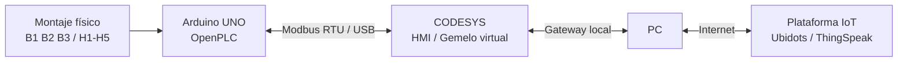

# RA3.2 - Gemelo Digital del Control de Nivel de un Tanque

Proyecto individual de **Automatización y Control de Procesos** orientado a extender la actividad RA2.3 mediante la creación de un gemelo digital del sistema de nivel de tanque.

**Autor:** Nicolás García Mejía  
**Actividad:** RA3.2 - Digital Twin - IoT Ecosystem  
**Fecha de sustentación:** 3 de noviembre de 2026

## Objetivo

Integrar el activo físico desarrollado en RA2.3 con su activo virtual en CODESYS mediante **Modbus**, publicar el estado del tanque en una plataforma IoT y habilitar al menos una acción de modificación remota.

## Arquitectura de trabajo

El computador se utiliza como gateway hacia Internet para reutilizar el Arduino UNO disponible y evitar requerir hardware adicional.

## Estado actual

| Fase | Estado |
|---|---|
| Activo físico heredado de RA2.3 | ✅ Funcional |
| Lógica OpenPLC | ✅ Validada |
| HMI CODESYS | ✅ Disponible |
| OpenPLC + Modbus RTU | ✅ Configurado y cargado |
| CODESYS Modbus Serial Client | ✅ Instalado |
| Puerto COM / RTU / Unit ID | ✅ Configurado |
| Canales FC02 y FC01 | ✅ Configurados |
| Mapeo `EntradasByte` / `SalidasByte` | ✅ Configurado |
| Lógica ST adaptada para señales físicas | ✅ Compila correctamente |
| Compilación CODESYS | ✅ 0 errores |
| Runtime `CODESYS Control Win V3 x64` | ✅ En ejecución |
| Gateway local | ✅ Activo |
| Dispositivo `NICOLASGM` | ✅ Detectado y activo |
| Inicio de sesión en runtime | ✅ Exitoso |
| Aplicación descargada en runtime | ✅ Cargada |
| Ejecución de aplicación | ✅ RUN |
| HMI online | ✅ Ejecutándose |
| Validación online Arduino ↔ CODESYS | 🟡 En comprobación |
| Publicación IoT | ⏳ Pendiente |
| Control desde IoT | ⏳ Pendiente |
| Validación integral | ⏳ Pendiente |

> La compilación actual finaliza con **0 errores**. Permanecen únicamente dos advertencias C0373 relacionadas con la ausencia de una visualización de arranque configurada, las cuales no impiden continuar con las pruebas de comunicación.

> La aplicación ya fue descargada al runtime local y ejecutada en modo **RUN**. La HMI se encuentra online y muestra la lógica del tanque. La siguiente prueba es confirmar que los cambios del montaje físico se reciben realmente desde Arduino mediante Modbus RTU.

## Documentación

1. [Síntesis y alcance](docs/01-sintesis.md)
2. [Activo físico](docs/02-activo-fisico.md)
3. [Activo virtual](docs/03-activo-virtual.md)
4. [Arquitectura y Modbus](docs/04-arquitectura-modbus.md)
5. [Integración IoT](docs/05-integracion-iot.md)
6. [Validación y resultados](docs/06-validacion-resultados.md)
7. [Conclusiones](docs/07-conclusiones.md)

## Relación con RA2.3

Este repositorio corresponde exclusivamente a **RA3.2**. El montaje físico, la lógica combinacional y la HMI se reutilizan como activos base de RA2.3 y aquí se documenta su evolución hacia un gemelo digital conectado.
