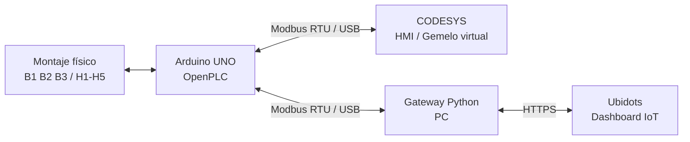

# RA3.2 - Gemelo Digital del Control de Nivel de un Tanque

Proyecto individual de **Automatización y Control de Procesos** orientado a extender la actividad RA2.3 mediante la creación de un gemelo digital del sistema de nivel de tanque.

**Autor:** Nicolás García Mejía  
**Actividad:** RA3.2 - Digital Twin - IoT Ecosystem  
**Fecha de sustentación:** 3 de noviembre de 2026

## Entrega principal

👉 **[Abrir Wiki técnica completa de RA3.2](WIKI.md)**

La wiki reúne la síntesis, arquitectura, activo físico, activo virtual, configuración Modbus, integración IoT, validación, resultados, limitaciones y conclusiones.

## Objetivo

Integrar el activo físico desarrollado en RA2.3 con su activo virtual en CODESYS mediante **Modbus**, preparar la publicación del estado del tanque en una plataforma IoT y habilitar una acción de modificación remota.

## Arquitectura

El computador se utiliza como gateway hacia Internet para reutilizar el Arduino UNO disponible y evitar requerir hardware adicional. Debido a que el puerto COM5 solo puede ser utilizado por un cliente a la vez, la validación CODESYS y la validación IoT se ejecutan por etapas sobre el mismo activo físico.

## Estado resumido

| Fase | Estado |
|---|---|
| Activo físico RA2.3 | ✅ Funcional |
| OpenPLC | ✅ Validado |
| HMI CODESYS | ✅ Funcional |
| Modbus RTU | ✅ Validado |
| Compilación CODESYS | ✅ 0 errores |
| START / STOP físicos | ✅ Validados |
| B1 / B2 / B3 físicos | ✅ Validados |
| H1-H5 | ✅ Validadas |
| Arduino → Modbus → CODESYS → HMI | ✅ Validado |
| Coil remoto D13 / `%QX0.5` | ✅ Configurado |
| Ubidots `Tanque_Digital` | ✅ Creado |
| Variables y dashboard IoT | ✅ Creados |
| Gateway Python | ✅ Preparado |
| Publicación IoT real | ⏳ Pendiente prueba final |
| Control IoT real | ⏳ Pendiente prueba final |

Durante el diagnóstico online de Modbus se registraron **3844 solicitudes y 0 errores**.

## Documentación detallada

1. [Síntesis y alcance](docs/01-sintesis.md)
2. [Activo físico](docs/02-activo-fisico.md)
3. [Activo virtual](docs/03-activo-virtual.md)
4. [Arquitectura y Modbus](docs/04-arquitectura-modbus.md)
5. [Integración IoT](docs/05-integracion-iot.md)
6. [Validación y resultados](docs/06-validacion-resultados.md)
7. [Conclusiones](docs/07-conclusiones.md)

## Relación con RA2.3

Este repositorio corresponde exclusivamente a **RA3.2**. El montaje físico, la lógica combinacional y la HMI se reutilizan como activos base de RA2.3 y aquí se documenta su evolución hacia un gemelo digital conectado.
