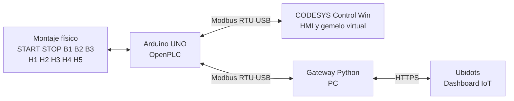
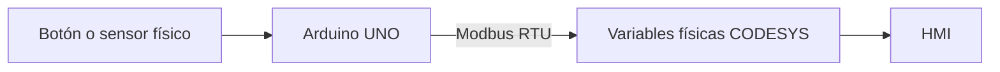

# Wiki técnica RA3.2 - Gemelo Digital del Control de Nivel de un Tanque

**Autor:** Nicolás García Mejía  
**Asignatura:** Automatización y Control de Procesos  
**Actividad:** RA3.2 - Digital Twin - IoT Ecosystem  
**Fecha de sustentación:** 3 de noviembre de 2026

---

## 1. Síntesis

La actividad RA3.2 extiende el sistema de control de nivel desarrollado en RA2.3 hacia un **gemelo digital**. Se reutiliza el montaje físico basado en Arduino UNO, la lógica de control implementada en OpenPLC y la HMI desarrollada en CODESYS.

El objetivo de la integración es mantener una representación coherente entre el activo físico y el activo virtual mediante **Modbus RTU**, y preparar una capa IoT en **Ubidots** para publicar variables del tanque y recibir una orden remota.

La solución evita agregar hardware adicional. El computador se utiliza como gateway hacia Internet y el mismo Arduino UNO permanece como microcontrolador principal.

---

## 2. Arquitectura



El puerto serial `COM5` solo puede ser utilizado por un cliente a la vez. Por esta razón, la validación CODESYS y la validación IoT se realizan por etapas sobre el mismo activo físico.

---

## 3. Activo físico

### Entradas

| Señal | Pin Arduino | Dirección IEC | Función |
|---|---:|---|---|
| START | D2 | `%IX0.0` | Inicio del sistema |
| STOP | D3 | `%IX0.1` | Parada del sistema |
| B1 | D4 | `%IX0.2` | Nivel inferior |
| B2 | D5 | `%IX0.3` | Nivel intermedio |
| B3 | D6 | `%IX0.4` | Nivel superior |

### Salidas

| Señal | Pin Arduino | Dirección IEC | Función |
|---|---:|---|---|
| H1 | D8 | `%QX0.0` | Nivel correcto |
| H2 | D9 | `%QX0.1` | Nivel bajo |
| H3 | D10 | `%QX0.2` | Nivel alto |
| H4 | D11 | `%QX0.3` | Tanque vacío |
| H5 | D12 | `%QX0.4` | Error de secuencia |
| Remoto | D13 | `%QX0.5` | Coil reservado para control remoto |

### Tabla funcional

| B1 | B2 | B3 | Resultado |
|---:|---:|---:|---|
| 0 | 0 | 0 | H4 - Tanque vacío |
| 1 | 0 | 0 | H2 - Nivel bajo |
| 1 | 1 | 0 | H1 - Nivel correcto |
| 1 | 1 | 1 | H3 - Nivel alto |
| 0 | 1 | 0 | H5 - Error |
| 0 | 0 | 1 | H5 - Error |
| 1 | 0 | 1 | H5 - Error |
| 0 | 1 | 1 | H5 - Error |

La combinación `000` representa un tanque vacío y no se considera una falla.

Durante las pruebas finales se validaron **START, STOP, B1, B2, B3 y H1-H5** en el montaje físico.

---

## 4. Activo virtual en CODESYS

La HMI de RA2.3 se reutilizó como activo virtual. Representa:

- START y STOP,
- RUN,
- B1, B2 y B3,
- H1, H2, H3, H4 y H5.

La lógica base es:

```text
H1 = RUN AND B1 AND B2 AND NOT B3
H2 = RUN AND B1 AND NOT B2 AND NOT B3
H3 = RUN AND B1 AND B2 AND B3
H4 = RUN AND NOT B1 AND NOT B2 AND NOT B3
H5 = RUN AND ((B2 AND NOT B1) OR (B3 AND NOT B2))
```

Para RA3.2 se incorporaron variables físicas recibidas por Modbus:

- `EntradasByte`
- `SalidasByte`
- `StartFisico`
- `StopFisico`
- `B1Fisico`, `B2Fisico`, `B3Fisico`
- `H1Fisico` a `H5Fisico`
- `ComandoRemoto`
- `ComandoRemotoByte`

La aplicación compila con **0 errores**. Permanecen únicamente advertencias C0373 asociadas a la ausencia de una visualización de arranque predeterminada, sin afectar la lógica o la comunicación.

---

## 5. Comunicación Modbus RTU

### Parámetros seriales

| Parámetro | Valor |
|---|---|
| Puerto | COM5 |
| Transporte | RTU |
| Unit / Slave ID | 1 |
| Baud rate | 115200 |
| Data bits | 8 |
| Parity | None |
| Stop bits | 1 |
| Timeout CODESYS | 1000 ms |
| Intervalo telegramas | 10 ms |

### Canales utilizados

#### Entradas_Tanque

- `FC02 - Read Discrete Inputs`
- Offset `0`
- Longitud `5`
- START, STOP, B1, B2 y B3

#### Salidas_Tanque

- `FC01 - Read Coils`
- Offset `0`
- Longitud `5`
- H1, H2, H3, H4 y H5

#### Comando_Remoto

- `FC05 - Write Single Coil`
- Offset `5`
- Coil asociado a `%QX0.5` / D13

### Mapeo en CODESYS

```text
Entradas_Tanque[0] -> TANQUE_ST.EntradasByte
Salidas_Tanque[0]  -> TANQUE_ST.SalidasByte
Comando_Remoto[0]  -> TANQUE_ST.ComandoRemotoByte
```

---

## 6. Validación Modbus y gemelo digital

Se verificó el runtime **CODESYS Control Win V3 x64** y el Gateway local. El dispositivo local `NICOLASGM` fue detectado como activo y la aplicación se descargó correctamente al runtime.

Durante la prueba online del dispositivo Modbus se observó:

- `Request Counter = 3844`
- `Error Counter = 0`

Posteriormente se accionaron físicamente START, STOP, B1, B2 y B3. CODESYS reflejó los cambios en las variables físicas y la HMI reprodujo el mismo estado.



### Resultados funcionales

| Prueba | Resultado |
|---|---|
| START físico → CODESYS | ✅ Validado |
| STOP físico → CODESYS | ✅ Validado |
| B1 físico → CODESYS | ✅ Validado |
| B1 + B2 → nivel correcto | ✅ Validado |
| B1 + B2 + B3 → nivel alto | ✅ Validado |
| Combinaciones incoherentes → H5 | ✅ Validado |
| H1-H5 físicas | ✅ Validadas |
| HMI reflejando el estado físico | ✅ Validado |
| Diagnóstico Modbus sin errores | ✅ Validado |

Con estas pruebas queda validada la cadena:

```text
Activo físico → Arduino UNO → Modbus RTU → CODESYS → HMI
```

---

## 7. Integración IoT con Ubidots

Se creó en Ubidots el dispositivo **Tanque_Digital** con seis variables Raw:

- `b1`
- `b2`
- `b3`
- `run`
- `estado_tanque`
- `comando_remoto`

También se creó el dashboard **Gemelo Digital - Tanque** con:

- widget **Indicator** para `b1`, `b2`, `b3` y `run`,
- widget **Switch** para `comando_remoto`.

La variable `estado_tanque` se plantea con la siguiente codificación:

| Valor | Estado |
|---:|---|
| 0 | Sistema detenido / sin estado |
| 1 | Tanque vacío |
| 2 | Nivel bajo |
| 3 | Nivel correcto |
| 4 | Nivel alto |
| 5 | Error de secuencia |

### Gateway IoT

Se preparó un gateway Python para ejecutar en Windows. Su función es:

1. leer el Arduino mediante Modbus RTU,
2. obtener B1, B2, B3 y las salidas H1-H5,
3. calcular `run` y `estado_tanque`,
4. publicar los valores por HTTPS en Ubidots,
5. consultar `comando_remoto`,
6. escribir ese valor sobre el coil 5 mediante FC05.

El comando remoto trabaja como:

```text
0 = OFF
1 = ON
```

### Estado de esta capa

| Elemento | Estado |
|---|---|
| Dispositivo Tanque_Digital | ✅ Creado |
| Variables Raw | ✅ Creadas |
| Dashboard | ✅ Creado |
| Indicadores | ✅ Configurados |
| Switch comando_remoto | ✅ Configurado |
| Coil D13 / %QX0.5 | ✅ Configurado |
| Gateway Python | ✅ Preparado |
| Publicación de datos reales | ⏳ Pendiente de prueba final con Arduino conectado |
| Orden Ubidots → Arduino | ⏳ Pendiente de validación final |

No se reportan como validadas las dos últimas pruebas porque aún no se ha realizado la ejecución final del gateway con el Arduino conectado.

---

## 8. Decisiones de diseño

### Reutilización del Arduino UNO

Se mantuvo el Arduino UNO porque el activo físico de RA2.3 ya estaba construido y validado. Esto redujo cambios de hardware y permitió concentrar la actividad en la integración digital.

### Modbus RTU por USB

Se utilizó Modbus RTU sobre el puerto serial porque es compatible con el montaje existente y permite comunicación directa entre Arduino y CODESYS sin adquirir módulos adicionales.

### PC como gateway IoT

El computador actúa como gateway hacia Ubidots. Esto permite incorporar conectividad a Internet aun cuando el Arduino UNO no dispone de Wi-Fi integrado.

### Validación por etapas

Debido a que `COM5` solo puede ser abierto por un cliente a la vez, la integración se valida en dos modos:

1. **Modo gemelo:** Arduino ↔ CODESYS.
2. **Modo IoT:** Arduino ↔ gateway Python ↔ Ubidots.

---

## 9. Limitaciones

- El Arduino UNO no tiene conectividad Wi-Fi propia.
- El puerto COM5 no puede ser utilizado simultáneamente por CODESYS y el gateway Python.
- La publicación real en Ubidots y el retorno `comando_remoto` requieren la prueba final con el Arduino conectado.
- La solución prioriza reutilizar el hardware disponible y evitar agregar componentes adicionales.

---

## 10. Conclusiones

La actividad permitió convertir el sistema de RA2.3 en una arquitectura de gemelo digital conectada. La integración **Arduino UNO ↔ Modbus RTU ↔ CODESYS** fue validada con entradas y salidas reales, HMI online y diagnóstico Modbus sin errores.

El activo físico y el activo virtual conservan el mismo comportamiento para los estados de tanque vacío, nivel bajo, nivel correcto, nivel alto y secuencia incoherente.

La capa IoT quedó estructurada mediante Ubidots, un dashboard de monitoreo/control y un gateway Python que reutiliza el mismo Arduino UNO. La prueba final de publicación y control IoT queda como último paso de validación práctica.

La arquitectura demuestra que un activo existente puede ampliarse hacia un gemelo digital sin reemplazar completamente el hardware original, integrando control físico, visualización virtual, protocolo industrial e infraestructura IoT.

---

## 11. Estado final de entrega

| Requisito RA3.2 | Estado |
|---|---|
| Utilizar/modificar activo físico RA2.3 | ✅ |
| Utilizar/modificar activo virtual RA2.3 | ✅ |
| Conectar ambos mediante Arduino y Modbus | ✅ |
| Publicar estado en plataforma IoT | 🟡 Implementado, pendiente prueba final |
| Modificar estado desde plataforma IoT | 🟡 Implementado, pendiente prueba final |
| Wiki con síntesis, soporte gráfico y narrativa técnica | ✅ |
| Sustentación de 5 minutos | ⏳ Clase |

---

## Navegación detallada

- [Síntesis y alcance](docs/01-sintesis.md)
- [Activo físico](docs/02-activo-fisico.md)
- [Activo virtual](docs/03-activo-virtual.md)
- [Arquitectura y Modbus](docs/04-arquitectura-modbus.md)
- [Integración IoT](docs/05-integracion-iot.md)
- [Validación y resultados](docs/06-validacion-resultados.md)
- [Conclusiones](docs/07-conclusiones.md)
