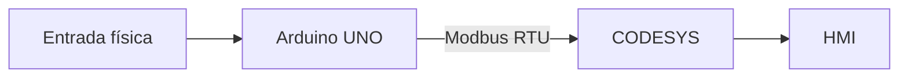
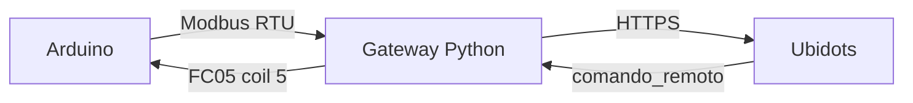

# Wiki técnica RA3.2 - Gemelo Digital del Control de Nivel de un Tanque

**Autor:** Nicolás García Mejía  
**Asignatura:** Automatización y Control de Procesos  
**Actividad:** RA3.2 - Digital Twin - IoT Ecosystem  
**Fecha de sustentación:** 3 de noviembre de 2026

---

## 1. Síntesis

La actividad RA3.2 extiende el sistema de control de nivel desarrollado en RA2.3 hacia un **gemelo digital**. Se reutiliza el montaje físico basado en Arduino UNO, la lógica de control en OpenPLC y la HMI desarrollada en CODESYS.

La solución mantiene sincronizado el activo físico con el activo virtual mediante **Modbus RTU** y añade una capa IoT en **Ubidots** para publicar el estado del tanque y recibir una orden remota.

---

## 2. Arquitectura


El puerto `COM5` solo puede ser utilizado por un cliente a la vez. Por ello, la validación CODESYS y la validación IoT se realizan por etapas sobre el mismo activo físico.

---

## 3. Activo físico

### Entradas

| Señal | Pin | Dirección IEC | Función |
|---|---:|---|---|
| START | D2 | `%IX0.0` | Inicio |
| STOP | D3 | `%IX0.1` | Parada |
| B1 | D4 | `%IX0.2` | Nivel inferior |
| B2 | D5 | `%IX0.3` | Nivel intermedio |
| B3 | D6 | `%IX0.4` | Nivel superior |

### Salidas

| Señal | Pin | Dirección IEC | Estado |
|---|---:|---|---|
| H1 | D8 | `%QX0.0` | Nivel correcto |
| H2 | D9 | `%QX0.1` | Nivel bajo |
| H3 | D10 | `%QX0.2` | Nivel alto |
| H4 | D11 | `%QX0.3` | Tanque vacío |
| H5 | D12 | `%QX0.4` | Error de secuencia |
| Remoto | D13 | `%QX0.5` | Orden remota IoT |

### Tabla funcional

| B1 | B2 | B3 | Resultado |
|---:|---:|---:|---|
| 0 | 0 | 0 | H4 - Vacío |
| 1 | 0 | 0 | H2 - Nivel bajo |
| 1 | 1 | 0 | H1 - Nivel correcto |
| 1 | 1 | 1 | H3 - Nivel alto |
| 0 | 1 | 0 | H5 - Error |
| 0 | 0 | 1 | H5 - Error |
| 1 | 0 | 1 | H5 - Error |
| 0 | 1 | 1 | H5 - Error |

La combinación `000` corresponde a tanque vacío, no a una falla.

Durante las pruebas finales se validaron **START, STOP, B1, B2, B3 y H1-H5** físicamente.

---

## 4. Activo virtual en CODESYS

La HMI de RA2.3 se reutilizó como activo virtual y representa START, STOP, RUN, B1-B3 y H1-H5.

La lógica base es:

```text
H1 = RUN AND B1 AND B2 AND NOT B3
H2 = RUN AND B1 AND NOT B2 AND NOT B3
H3 = RUN AND B1 AND B2 AND B3
H4 = RUN AND NOT B1 AND NOT B2 AND NOT B3
H5 = RUN AND ((B2 AND NOT B1) OR (B3 AND NOT B2))
```

Para RA3.2 se incorporaron `EntradasByte`, `SalidasByte`, las señales físicas individuales y `ComandoRemoto` / `ComandoRemotoByte`.

La aplicación compila con **0 errores**. Las advertencias C0373 corresponden únicamente a la ausencia de una visualización de arranque predeterminada y no afectan la lógica ni Modbus.

---

## 5. Comunicación Modbus RTU

### Parámetros

| Parámetro | Valor |
|---|---|
| Puerto | COM5 |
| Transporte | RTU |
| Unit ID | 1 |
| Baud rate | 115200 |
| Data bits | 8 |
| Parity | None |
| Stop bits | 1 |
| Timeout | 1000 ms |
| Reinicio automático | Activado |

### Canales

- `Entradas_Tanque`: **FC02**, offset 0, longitud 5.
- `Salidas_Tanque`: **FC01**, offset 0, longitud 5.
- `Comando_Remoto`: **FC05**, offset 5, asociado a `%QX0.5` / D13.

### Mapeo CODESYS

```text
Entradas_Tanque[0] -> TANQUE_ST.EntradasByte
Salidas_Tanque[0]  -> TANQUE_ST.SalidasByte
Comando_Remoto[0]  -> TANQUE_ST.ComandoRemotoByte
```

---

## 6. Validación CODESYS + Modbus

El runtime **CODESYS Control Win V3 x64** y el Gateway local fueron detectados correctamente. El dispositivo `NICOLASGM` quedó activo y la aplicación fue descargada al runtime.

Durante la validación se observaron diagnósticos sin errores, incluyendo:

- `Request Counter = 3844`, `Error Counter = 0`.
- En la prueba final del 3 de noviembre de 2026, `Request Counter = 143` y aumentando, `Error Counter = 0`.
- Estado Modbus: **En ejecución**.

Se verificó físicamente START, STOP, B1, B2 y B3. CODESYS reflejó los cambios y la HMI reprodujo el mismo estado.



### Resultados

| Prueba | Resultado |
|---|---|
| START físico → CODESYS | ✅ |
| STOP físico → CODESYS | ✅ |
| B1 físico → CODESYS | ✅ |
| B1 + B2 → H1 | ✅ |
| B1 + B2 + B3 → H3 | ✅ |
| Secuencia incoherente → H5 | ✅ |
| H1-H5 físicas | ✅ |
| HMI reflejando activo físico | ✅ |
| Diagnóstico Modbus sin errores | ✅ |

Con esto queda validada la cadena:

```text
Activo físico → Arduino UNO → Modbus RTU → CODESYS → HMI
```

---

## 7. Integración IoT con Ubidots

Se creó el dispositivo **Tanque_Digital** con las variables:

- `b1`
- `b2`
- `b3`
- `run`
- `estado_tanque`
- `comando_remoto`

El dashboard **Gemelo Digital - Tanque** contiene un indicador para `b1`, `b2`, `b3` y `run`, además de un switch para `comando_remoto`.

### Codificación de estado

| Valor | Estado |
|---:|---|
| 0 | Sistema detenido |
| 1 | Tanque vacío |
| 2 | Nivel bajo |
| 3 | Nivel correcto |
| 4 | Nivel alto |
| 5 | Error de secuencia |

### Gateway Python

El gateway ejecutado en Windows:

1. abre Modbus RTU sobre COM5,
2. lee B1-B3 y H1-H5,
3. calcula `run` y `estado_tanque`,
4. publica los valores por HTTPS en Ubidots,
5. consulta `comando_remoto`,
6. escribe el valor recibido sobre el coil 5 mediante FC05.

Durante la prueba real se obtuvo:

```text
Modbus OK: COM5, 115200 baud, parity N
Gateway IoT iniciado
Ubidots comando_remoto -> OFF
B1=0 B2=0 B3=0 | RUN=0 ESTADO=0 | REMOTO=0
```

Posteriormente se activó el switch `comando_remoto` desde Ubidots y **la orden se reflejó físicamente en el Arduino mediante D13**, validando el camino de retorno.



### Estado IoT final

| Elemento | Estado |
|---|---|
| Dispositivo Tanque_Digital | ✅ |
| Variables Raw | ✅ |
| Dashboard | ✅ |
| Indicadores | ✅ |
| Switch comando_remoto | ✅ |
| Gateway Python | ✅ |
| Publicación Arduino → Ubidots | ✅ |
| Lectura Ubidots → gateway | ✅ |
| Orden Ubidots → Arduino / D13 | ✅ |

> No se creó un STOP remoto independiente en Ubidots porque la actividad solo requiere demostrar una modificación remota del estado. Esa función ya se cumple con `comando_remoto`. El **STOP físico** sí está implementado y validado en Arduino/CODESYS.

---

## 8. Decisiones de diseño

- Se mantuvo el **Arduino UNO** para reutilizar el activo físico de RA2.3.
- Se utilizó **Modbus RTU por USB** para evitar hardware adicional.
- El **PC funciona como gateway IoT** porque el Arduino UNO no dispone de Wi-Fi integrado.
- La validación se divide en modo gemelo y modo IoT porque COM5 solo puede ser utilizado por un cliente a la vez.

---

## 9. Limitaciones

- El Arduino UNO no posee conectividad Wi-Fi integrada.
- CODESYS y el gateway Python no pueden abrir COM5 simultáneamente.
- La arquitectura prioriza reutilización y bajo costo frente a una implementación con hardware IoT dedicado.

---

## 10. Conclusiones

La integración **Arduino UNO ↔ Modbus RTU ↔ CODESYS** fue validada con entradas y salidas reales, HMI online y diagnóstico sin errores.

La capa IoT también fue validada. El sistema publicó datos reales en Ubidots y recibió una orden desde el dashboard que produjo una respuesta física observable en el Arduino a través del coil remoto D13.

Por tanto, el proyecto cumple el objetivo de representar el activo físico mediante un gemelo digital y extenderlo hacia un ecosistema IoT sin reemplazar el hardware original.

---

## 11. Estado final de entrega

| Requisito RA3.2 | Estado |
|---|---|
| Utilizar/modificar activo físico RA2.3 | ✅ |
| Utilizar/modificar activo virtual RA2.3 | ✅ |
| Conectar ambos mediante Arduino y Modbus | ✅ |
| Publicar estado en plataforma IoT | ✅ |
| Modificar estado desde plataforma IoT | ✅ |
| Wiki con síntesis, soporte gráfico y narrativa técnica | ✅ |
| Sustentación de 5 minutos | ⏳ Clase |

---

## Navegación detallada

- [Síntesis y alcance](docs/01-sintesis.md)
- [Activo físico](docs/02-activo-fisico.md)
- [Activo virtual](docs/03-activo-virtual.md)
- [Arquitectura y Modbus](docs/04-arquitectura-modbus.md)
- [Integración IoT](docs/05-integracion-iot.md)
- [Validación y resultados](docs/06-validacion-resultados.md)
- [Conclusiones](docs/07-conclusiones.md)
