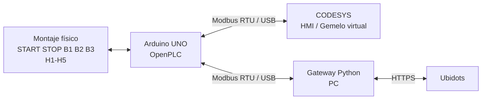

# 4. Arquitectura y comunicación Modbus

## Arquitectura



La solución reutiliza el Arduino UNO existente. El computador actúa como gateway hacia Internet, por lo que no se requiere un ESP32 adicional.

## OpenPLC + Modbus RTU

Se utilizó una variante del proyecto denominada `Tanque_V2_Modbus`, conservando la lógica física e incorporando comunicación Modbus RTU.

### Parámetros

- Unit / Slave ID: `1`
- Baud rate: `115200`
- Data bits: `8`
- Parity: `None`
- Stop bits: `1`
- Transporte: `RTU`

### Discrete Inputs - FC02

| Dirección | Variable | IEC | Pin |
|---:|---|---|---:|
| 0 | START | `%IX0.0` | D2 |
| 1 | STOP | `%IX0.1` | D3 |
| 2 | B1 | `%IX0.2` | D4 |
| 3 | B2 | `%IX0.3` | D5 |
| 4 | B3 | `%IX0.4` | D6 |

### Coils - FC01 / FC05

| Dirección | Variable | IEC | Pin | Uso |
|---:|---|---|---:|---|
| 0 | H1 | `%QX0.0` | D8 | Lectura FC01 |
| 1 | H2 | `%QX0.1` | D9 | Lectura FC01 |
| 2 | H3 | `%QX0.2` | D10 | Lectura FC01 |
| 3 | H4 | `%QX0.3` | D11 | Lectura FC01 |
| 4 | H5 | `%QX0.4` | D12 | Lectura FC01 |
| 5 | Remoto | `%QX0.5` | D13 | Escritura FC05 |

## Configuración en CODESYS

Se instaló **CODESYS Modbus Serial Client SL** y se agregó la cadena:

```text
CODESYS_Control_Win_V3_x64
└── Modbus_COM_Port
    └── Modbus_Client_COM_Port
        └── Modbus_Esclavo_puerto_COM
```

### Puerto serie

- COM Port: `5`
- Baud rate: `115200`
- Parity: `None`
- Data bits: `8`
- Stop bits: `1`
- Modo: `RTU`
- Timeout: `1000 ms`
- Tiempo entre telegramas: `10 ms`
- Unit ID: `1`

## Canales Modbus

### `Entradas_Tanque`

- `FC02 - Read Discrete Inputs`
- Offset `0`
- Longitud `5`
- Ciclo `100 ms`

### `Salidas_Tanque`

- `FC01 - Read Coils`
- Offset `0`
- Longitud `5`
- Ciclo `100 ms`

### `Comando_Remoto`

- `FC05 - Write Single Coil`
- Offset `5`
- Longitud `1`
- Ciclo `100 ms`

## Mapeo en CODESYS

```text
Entradas_Tanque[0] -> TANQUE_ST.EntradasByte
Salidas_Tanque[0]  -> TANQUE_ST.SalidasByte
Comando_Remoto[0]  -> TANQUE_ST.ComandoRemotoByte
```

CODESYS agrupa los bits de los canales en bytes. A partir de `EntradasByte` y `SalidasByte` se separan las señales individuales mediante acceso por bit.

## Validación de compilación

La recompilación finalizó con:

- **0 errores**,
- advertencias C0373 únicamente por ausencia de visualización de arranque predeterminada.

Estas advertencias no afectan la lógica ni la comunicación Modbus.

## Runtime y diagnóstico

Se verificó **CODESYS Control Win V3 x64** en ejecución y el dispositivo local `NICOLASGM` activo.

La aplicación fue descargada al runtime y ejecutada en modo RUN. En el diagnóstico Modbus se observó:

- `Request Counter = 3844`
- `Error Counter = 0`

## Validación funcional

Se accionaron físicamente START, STOP, B1, B2 y B3 y CODESYS reflejó correctamente los cambios. Las combinaciones de sensores reprodujeron H1-H5 tanto en el montaje como en la HMI.

Por tanto queda validada la cadena:

```text
Activo físico -> Arduino UNO -> Modbus RTU -> CODESYS -> HMI
```

El coil 5 / D13 quedó configurado como canal de escritura para la etapa de control remoto e integración IoT.
