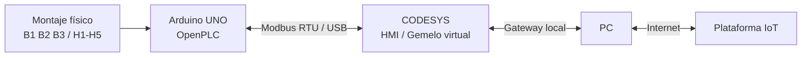

# 4. Arquitectura y comunicación Modbus

## Arquitectura



La solución reutiliza el Arduino UNO existente. El computador actúa como gateway hacia Internet, por lo que no se requiere un ESP32 adicional.

## OpenPLC + Modbus RTU

Se generó una variante del proyecto denominada `Tanque_V2_Modbus`, conservando la lógica física e incorporando un servidor Modbus RTU.

### Parámetros

- Unit / Slave ID: `1`
- Baud rate: `115200`
- Data bits: `8`
- Parity: `None`
- Stop bits: `1`
- Transporte: `RTU`

### Discrete Inputs - FC02

| Dirección | Variable | IEC | Pin |
|---:|---|---|---:|
| 0 | START | `%IX0.0` | D2 |
| 1 | STOP | `%IX0.1` | D3 |
| 2 | B1 | `%IX0.2` | D4 |
| 3 | B2 | `%IX0.3` | D5 |
| 4 | B3 | `%IX0.4` | D6 |

### Coils - FC01

| Dirección | Variable | IEC | Pin |
|---:|---|---|---:|
| 0 | H1 | `%QX0.0` | D8 |
| 1 | H2 | `%QX0.1` | D9 |
| 2 | H3 | `%QX0.2` | D10 |
| 3 | H4 | `%QX0.3` | D11 |
| 4 | H5 | `%QX0.4` | D12 |

## Configuración prevista en CODESYS

```text
Device
└── Modbus COM Port
    └── Modbus Serial Client
        └── Arduino / Modbus Serial Server
```

Se plantean dos grupos de lectura:

### Grupo 1

- Función: `FC02 - Read Discrete Inputs`
- Offset: `0`
- Longitud: `5`
- Variables: START, STOP, B1, B2, B3

### Grupo 2

- Función: `FC01 - Read Coils`
- Offset: `0`
- Longitud: `5`
- Variables: H1, H2, H3, H4, H5

## Estado actual

La variante Modbus fue cargada en el Arduino y el montaje continuó funcionando. La siguiente fase es completar la configuración de CODESYS y comprobar que las variables cambian desde el activo físico.

> Pendiente: captura del árbol Modbus en CODESYS y validación online.
