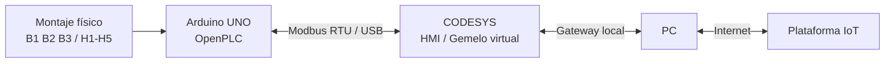

# 4. Arquitectura y comunicación Modbus

## Arquitectura



La solución reutiliza el Arduino UNO existente. El computador actúa como gateway hacia Internet, por lo que no se requiere un ESP32 adicional.

## OpenPLC + Modbus RTU

Se generó una variante del proyecto denominada `Tanque_V2_Modbus`, conservando la lógica física e incorporando un servidor Modbus RTU.

### Parámetros

- Unit / Slave ID: `1`
- Baud rate: `115200`
- Data bits: `8`
- Parity: `None`
- Stop bits: `1`
- Transporte: `RTU`

### Discrete Inputs - FC02

| Dirección | Variable | IEC | Pin |
|---:|---|---|---:|
| 0 | START | `%IX0.0` | D2 |
| 1 | STOP | `%IX0.1` | D3 |
| 2 | B1 | `%IX0.2` | D4 |
| 3 | B2 | `%IX0.3` | D5 |
| 4 | B3 | `%IX0.4` | D6 |

### Coils - FC01

| Dirección | Variable | IEC | Pin |
|---:|---|---|---:|
| 0 | H1 | `%QX0.0` | D8 |
| 1 | H2 | `%QX0.1` | D9 |
| 2 | H3 | `%QX0.2` | D10 |
| 3 | H4 | `%QX0.3` | D11 |
| 4 | H5 | `%QX0.4` | D12 |

## Configuración realizada en CODESYS

Se instaló el complemento **CODESYS Modbus Serial Client SL** y se agregó la cadena de dispositivos Modbus al proyecto existente de CODESYS.

```text
CODESYS_Control_Win_V3_x64
└── Modbus_COM_Port
    └── Modbus_Client_COM_Port
        └── Modbus_Esclavo_puerto_COM
```

### Puerto serie

El `Modbus_COM_Port` quedó configurado para el Arduino conectado a `COM5`:

- COM Port: `5`
- Baud rate: `115200`
- Parity: `None`
- Data bits: `8`
- Stop bits: `1`

El cliente utiliza modo **RTU**, tiempo de espera de respuesta de `1000 ms` y un intervalo de `10 ms` entre telegramas.

### Dispositivo remoto

El dispositivo serie Modbus asociado al Arduino utiliza:

- Dirección de servidor / Unit ID: `1`
- Timeout: `1000 ms`

## Canales Modbus configurados

Se crearon dos canales cíclicos con período de `100 ms`:

### `Entradas_Tanque`

- Función: `FC02 - Read Discrete Inputs`
- Offset: `0`
- Longitud: `5`
- Variables: START, STOP, B1, B2 y B3

### `Salidas_Tanque`

- Función: `FC01 - Read Coils`
- Offset: `0`
- Longitud: `5`
- Variables: H1, H2, H3, H4 y H5

CODESYS agrupa cada conjunto de cinco bits dentro de un byte. Se crearon en `TANQUE_ST` las variables `EntradasByte` y `SalidasByte` y se mapearon de esta forma:

```text
Entradas_Tanque[0] -> TANQUE_ST.EntradasByte
Salidas_Tanque[0]  -> TANQUE_ST.SalidasByte
```

A partir de estos bytes se obtienen las señales individuales `StartFisico`, `StopFisico`, `B1Fisico`, `B2Fisico`, `B3Fisico` y `H1Fisico` a `H5Fisico` mediante acceso por bits.

La lógica de CODESYS fue ampliada para aceptar tanto los controles de la HMI como las señales provenientes del activo físico, conservando la funcionalidad original del gemelo virtual.

## Validación de compilación

Después de corregir la separación entre la sección de declaraciones y la implementación ST, se ejecutó una recompilación completa del proyecto.

Resultado:

- **0 errores de compilación**.
- **2 advertencias C0373** relacionadas únicamente con la falta de una visualización de arranque configurada.
- El proyecto queda **listo para descarga** al runtime de CODESYS.

Estas advertencias no afectan la lógica del tanque ni la configuración Modbus y no bloquean la siguiente etapa de validación online.

## Estado actual

La configuración estructural de Modbus en CODESYS ya está completada y validada a nivel de compilación: puerto serie, cliente, dispositivo remoto, canales FC01/FC02, mapeo de bytes y lógica ST asociada.

El siguiente paso es iniciar sesión en el runtime de CODESYS y comprobar que los cambios físicos realizados en el Arduino se reflejen online en `EntradasByte`, `SalidasByte` y las variables individuales del gemelo digital.

> Pendiente de validación: comunicación online Arduino ↔ CODESYS y captura de variables cambiando en tiempo real.
